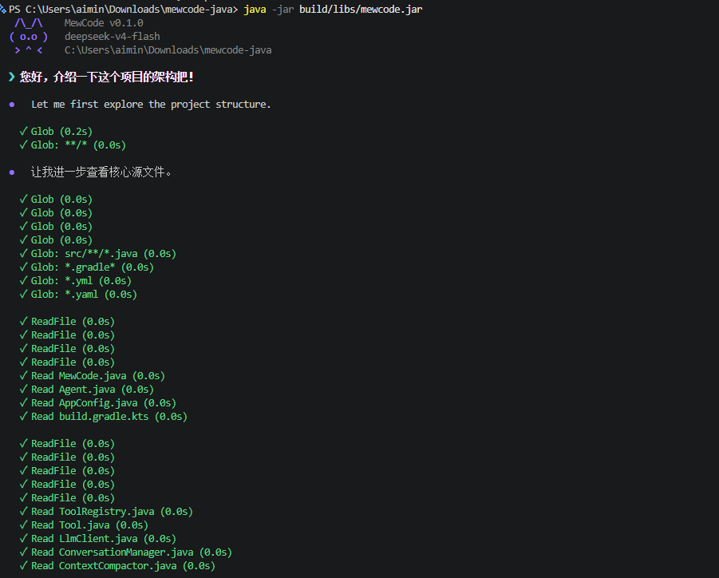
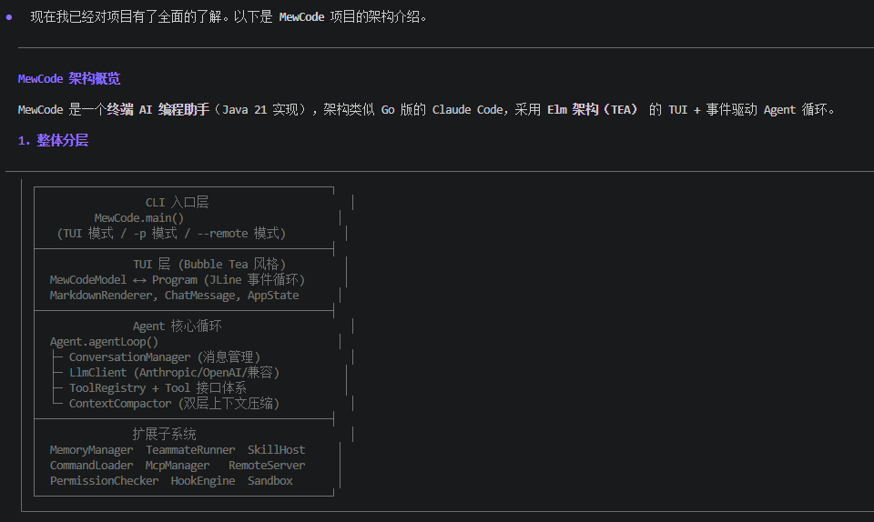
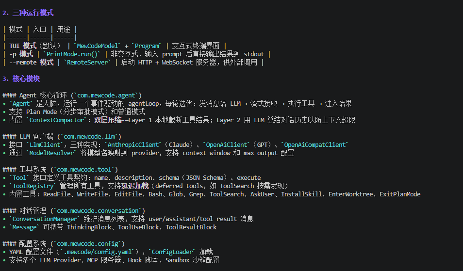
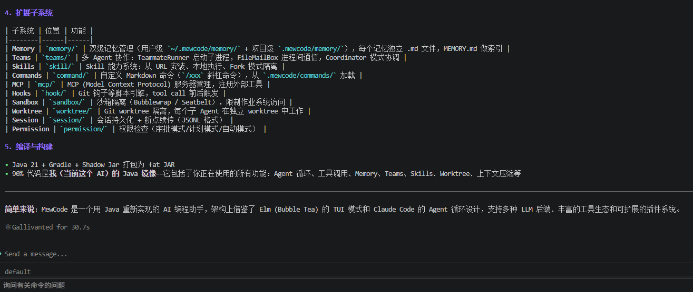
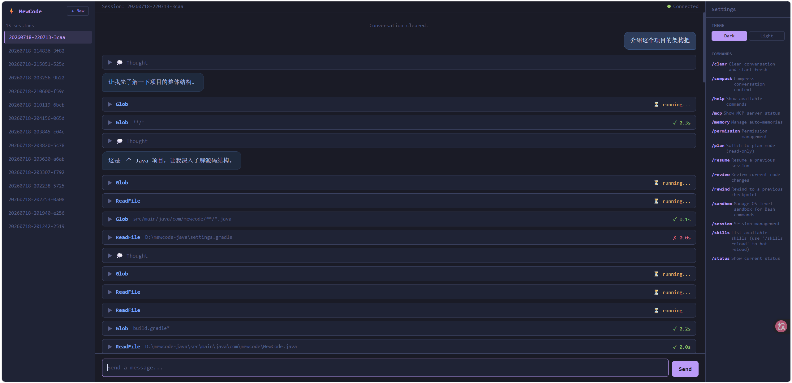
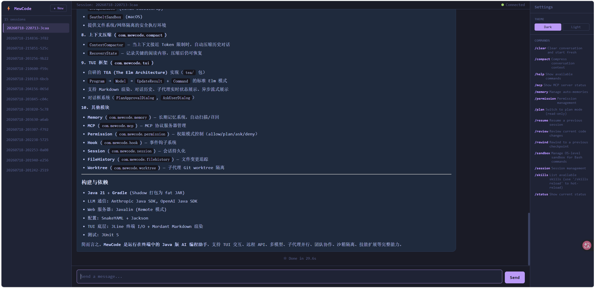

# MewAgent

[](https://www.java.com)
[](LICENSE)

**简体中文**

MewAgent 是一款自托管的 AI 编程助手，运行在终端中。它在你的项目前运行一个
LLM 驱动的 Agent，提供工具执行、MCP 协议扩展、技能系统、团队协作以及完整的
控制平面。

MewAgent 面向单个开发者工作站或小型可信团队，不是一个公开的多租户 AI 平台或
模型网关。

## 项目定位

MewAgent Java 适合这些场景：

- 本地代码助手：在现有仓库里做阅读、修改、重构、排查问题。
- Agent Runtime 原型：验证 `tool use`、`session resume`、`context compaction`、`MCP` 等能力。
- 私有化开发助手：接入 `OpenAI`、`Anthropic` 或 `OpenAI Compatible` 平台，构建团队内部开发工具。
- 多 Agent 协作实验：通过 `subagent`、`team`、`coordinator mode` 拆分复杂任务。

它当前更适合作为：

- 开源原型项目
- 内部研发工具底座
- 创业项目 MVP 的技术起点

## 系统截图

|  |  |
| ------------------------------------------------------------ | ------------------------------------------------------------ |
|  |  |
|          |  |

## 已实现的功能

- **Agent 循环** — 多轮对话与自主工具调用。LLM 规划 → 执行工具 → 汇总结果，
  支持可配置的迭代上限和输出失败恢复。
- **内置工具** — ReadFile、WriteFile、EditFile、Bash、Glob、Grep、ToolSearch、
  TaskCreate、AskUser、EnterWorktree、ExitWorktree、ExitPlanMode、InstallSkill、
  CreatePullRequest（有前置校验，`gh` 缺失时降级为 compare 链接）。
- **MCP 协议** — 连接任意 MCP 服务器（stdio / Streamable HTTP）作为外部工具，
  无需修改 MewAgent 即可扩展工具集合。
- **技能系统** — 以 `SKILL.md` + YAML 前置元数据声明的轻量插件。延迟加载：
  上下文只保留名称和描述，完整 SOP 在意图匹配时按需加载。支持脚本、引用和模板。
- **斜杠命令** — 技能注册为 `/command`，用户可直接触发。
- **钩子系统** — 9 个生命周期事件、4 种执行器类型（命令、提示注入、HTTP 通知、
  子 Agent 任务）。`pre_tool_use` 支持通过参数内容拦截实现细粒度安全策略。
- **记忆系统** — 用户级（`~/.mewagent/memory/`）和项目级（`.mewagent/memory/`）
  持久化记忆文件。每 5 轮自动进行 LLM 提取。查询时通过侧查询选择器预取相关记忆。
- **团队协作** — 生成子 Agent 作为队友，拥有独立终端和邮箱通信。支持协调者
  模式进行任务分发。支持 Tmux 和 iTerm 后端。
- **权限控制** — 3 种模式：`default`（写/破坏性操作前询问）、`plan`（先提案
  再批准后执行）、`auto`（完全自主）。
- **上下文压缩** — 接近上下文窗口限制时自动压缩。恢复状态写入会话文件以支持
  断点续传。
- **沙箱执行** — bwrap / seatbelt 隔离 Bash 工具。
- **计划模式** — 提案 → 审查 diff → 批准/拒绝后再应用更改。
- **打印模式** — 非交互模式，使用 `-p` 参数单次提示并输出到 stdout。
- **远程服务器** — 通过 `--remote` 启动 HTTP + WebSocket 服务，附带内置 Web UI
  与 REST 任务接口（`POST /task`），可供浏览器、编辑器插件和 CI 调用。
- **容器化运行** — 多阶段 Docker 镜像，以非 root 用户运行；Linux 环境下
  bubblewrap 沙箱开箱可用，不受 Windows 宿主降级路径的影响。
- **会话管理** — 磁盘 JSONL 会话记录、带 diff 恢复的文件历史追踪。
- **LLM 提供商** — Anthropic Messages API、OpenAI Chat Completions，以及
  OpenAI 兼容提供商（DeepSeek 等），通过 `openai-compat` 协议接入。

## 技术核心

- **Agent 循环：** 用户输入 → LLM 调用 → 工具执行 → 结果反馈 → 下一轮 LLM
  调用 → 重复直到输出纯文本响应。每个工具调用恰好经过 LLM 一次往返。
  `maxIterations` 可配置，防止失控循环。

- **延迟加载工具和技能：** 工具通过 `ShouldDefer()` 注册为"延迟"模式——上下文
  中只出现工具名称，模型通过 ToolSearch 按需获取完整 Schema。技能同理：
  启动时只加载前置元数据（名称+描述），Agent 匹配意图时才加载完整的 SKILL.md。

- **提示缓存优化：** 稳定的系统提示内容在 Agent 循环的轮次间缓存。动态内容
  （用户消息、工具结果）保持在 `messages` 数组中，以最大化缓存命中率并降低
  Token 消耗。

- **事件驱动钩子系统：** 9 个生命周期事件、4 种动作类型、支持 glob/regex/前缀
  条件匹配、once/async/onError 策略。所有钩子规则位于
  `.mewagent/config.yaml`——用配置代替代码，无需重新编译。

- **记忆召回：** 非阻塞预取与主 LLM 调用并行执行。侧查询选择器模型从用户级
  和项目级目录中选取相关记忆文件，在下一轮以 `system-reminder` 方式注入内容。

- **多 Agent 团队协调：** Agent 通过邮箱抽象（基于文件或内存）通信。协调者
  分配任务，队友独立工作，由主导 Agent 汇总结果。

- **严格角色交替：** 工具结果以 `user`/`tool` 角色发送，绝不使用 `assistant`
  角色。这遵守了 API 要求中 assistant 消息必须与 user 消息交替出现的约束。

## 系统架构

```
flowchart LR
    User[User] --> TUI[TUI / Terminal]
    User --> Remote[Remote UI / Browser]
    User --> Print[Print Mode]
    TUI --> Core[Agent Runtime]
    Remote --> Core
    Print --> Core
    Core --> LLM[LLM Provider]
    Core --> Tools[Tool Registry]
    Core --> Session[Session Manager]
    Core --> Memory[Instructions / Memory / Skills]
    Core --> MCP[MCP Servers]
    Tools --> Workspace[Project Workspace]
```


整体链路大致是：

1. 启动程序并加载 `.mewagent/config.yaml`
2. 初始化模型客户端、工具、权限、会话、记忆和 MCP
3. 用户通过 TUI、Remote UI 或 Print Mode 发起请求
4. Agent 调用模型，模型按需发起 `tool use`
5. 工具结果写回上下文，必要时做上下文压缩
6. 会话持久化到 `.mewagent/sessions`


## 升级迁移（MewCode → MewAgent）

如果你从 MewCode 升级，首次启动时会自动把 `~/.mewcode/` 下的历史数据
（sessions、memory、file-history、skills、config.yaml）迁移到 `~/.mewagent/`。
原目录会保留为 `.mewcode.bak.<timestamp>` 直到下次启动后清理。

环境变量从 `MEWCODE_CONFIG` 改为 `MEWAGENT_CONFIG`（旧值仍可读取，带弃用警告）。

## 快速开始

环境要求

- `JDK 21`
- 有效的 LLM API Key
- 可联网下载 Gradle 依赖

准备配置文件

在项目根目录创建：

```bash
# 配置
cp .mewagent/config.yaml.example .mewagent/config.yaml
```

编辑 `.mewagent/config.yaml`，至少配置你的提供商：

```yaml
providers:
  - name: deepseek
    protocol: openai-compat
    base_url: https://api.deepseek.com
    api_key: YOUR_API_KEY
    model: deepseek-v4-flash

permission_mode: default

mcp_servers:
  - name: context7
    command: npx.cmd
    args: ["-y", "@upstash/context7-mcp"]
```

构建并运行：

```bash
.\gradlew.bat shadowJar
java -jar build/libs/mewagent.jar
```

或使用启动脚本：

```bash
./mewagent
```

## 连接你的编辑器

远程模式启动一个 HTTP + WebSocket 服务，浏览器直接打开就是内置 Web UI，
外部客户端也可以通过 WebSocket 接入：

```bash
# 已构建的 jar
java -jar build/libs/mewagent.jar --remote=:18888

# 或直接用 Gradle 跑
.\gradlew.bat run --args='--remote'
```

打开 `http://127.0.0.1:18888` 即进入 Web 界面。端口可省略，默认为 `18888`；
需要监听所有网卡时用 `--remote=0.0.0.0:18888`（此时建议同时设置
`MEWAGENT_TASK_TOKEN`，见下文）。

## REST 任务接口

远程模式额外提供三个 HTTP 接口，供 CI / 告警系统调用，不需要 WebSocket 客户端。

| 方法 | 路径 | 说明 |
|---|---|---|
| `POST` | `/task` | 提交任务，body `{"prompt": "...", "wait": false}` |
| `GET` | `/task/{id}` | 查询单个任务的状态与结果 |
| `GET` | `/tasks` | 最近 50 条任务（按创建时间倒序） |

```bash
curl -X POST http://127.0.0.1:18888/task \
  -H 'Content-Type: application/json' \
  -d '{"prompt": "修复 src/ 下失败的测试", "wait": true}'
```

```json
{
  "taskId": "task_1052813191854200",
  "status": "completed",
  "result": "已修复 …",
  "inputTokens": 5567,
  "outputTokens": 3,
  "turns": 1,
  "durationMs": 912
}
```

任务在单线程队列中串行执行——Agent 实例与对话管理器是单例，不能并发驱动。
`wait=true` 最多同步等待 5 分钟，超时返回 `202`，改用 `GET /task/{id}` 轮询。

**鉴权**：设置 `MEWAGENT_TASK_TOKEN` 后，三个接口都要求
`Authorization: Bearer <token>`（常量时间比较）。未设置时不鉴权，仅限本地使用。

**权限**：REST 任务无人值守，没有界面可弹窗，工具权限请求一律自动放行
（单次批准，不写入 allow-always 规则）。请配合沙箱或容器隔离使用，
不要把该接口暴露到不受信任的网络。

## 验证

```bash
# 启动 TUI
java -jar build/libs/mewagent.jar

# 打印模式（非交互）
java -jar build/libs/mewagent.jar -p "列出 src/ 下所有 .java 文件"

# 远程模式
java -jar build/libs/mewagent.jar --remote=:18888

# 运行测试
./gradlew test
```

## 重要操作说明

- Agent 循环的 `maxIterations` 默认值已设为安全上限；可在配置中为长时间任务
  调整。如果 LLM 批量生成并发工具调用，单轮可能超过此限制。
- 权限模式防止意外写入。`default` 模式在写/破坏性操作前询问；`plan` 模式要求
  先提案再批准，之后才能执行工具。
- 记忆提取每 5 轮自动执行一次。手动记忆文件可放入 `~/.mewagent/memory/`
  （用户级）或 `.mewagent/memory/`（项目级）。
- MCP 服务器进程由 MewAgent 管理：按需启动，会话期间保持运行，关闭时终止。
- 上下文压缩在接近上下文窗口限制时自动触发。恢复状态写入会话 JSONL 文件，
  支持中断后恢复。
- 远程模式（`--remote`）默认监听 localhost。暴露到网络需要 TLS 反向代理。
  远程模式为无状态请求，不支持会话级记忆保留。
- 成本和 Token 数值来自 LLM 提供商的操作估算，并非硬性保证。用量以上游返回
  值为准。

## 安全

- 配置文件不要纳入版本控制。不要提交包含 API 密钥的 `.mewagent/config.yaml`。
- 权限模式可防止意外写入文件和执行命令。
- 沙箱执行（bwrap/seatbelt）启用后可隔离 Bash 命令与宿主系统。未启用沙箱时，
  Bash 工具拥有主机级访问权限。
- MCP 服务器以子进程运行，权限与 MewAgent 相同。只连接受信任的 MCP 服务器。
- 远程模式（`--remote`）默认监听 localhost。使用 TLS 反向代理提供网络访问。
  不要将后端直接暴露到公网。
- 从不可信来源加载的技能可能执行任意命令。安装前请审查 `SKILL.md` 文件。

## Docker

镜像基于 Linux，因此 OS 级沙箱（bubblewrap）可完整启用——Windows 宿主上
`SandboxFactory` 返回 `null` 的降级路径在容器内不会触发。

```bash
docker compose up -d --build

# 首次启动后导入配置（命名卷初始为空）
docker compose cp .mewagent/config.yaml mewagent:/home/agent/.mewagent/config.yaml
docker compose restart
```

或直接用 docker run：

```bash
docker build -t mewagent .

docker run -it --rm -p 18888:18888 \
  -v "$PWD:/workspace" \
  -v "$HOME/.mewagent:/home/agent/.mewagent" \
  mewagent --remote
```

容器内以非 root 用户 `agent`（uid 1000）运行，工作目录固定为 `/workspace`。
需要 bwrap 沙箱时 compose 已声明 `SYS_ADMIN` 与 `seccomp:unconfined`；不需要
沙箱可删掉这两项，`SandboxFactory` 会自动降级为路径白名单校验。

### 访问与验证

启动后浏览器打开 `http://127.0.0.1:18888` 即进入 Web UI。`--remote` 是服务模式，
长期运行换成 `-d`；只有需要交互式 TUI 时才加 `-it`。

```bash
# 约 30 秒后转为 healthy（HEALTHCHECK 探测首页）
docker ps --format '{{.Names}}\t{{.Status}}'

# REST 接口连通性，未提交过任务时返回空列表
curl -s http://127.0.0.1:18888/tasks
# {"tasks":[],"count":0}
```

本机构建产物参考：镜像 723MB，容器内 `uid=1000(agent)`，`health=healthy`，
访问不存在的任务返回 `404`。容器首次启动缺少配置文件时，入口会打印三种挂载
方式并退出，不会静默失败。

### 网络受限时的构建

`gradle-wrapper` 要从 `services.gradle.org` 下载发行版，而该域名会重定向到
GitHub Releases，部分网络下不可达。把本机已下载好的发行版放进构建上下文即可，
wrapper 命中 `*.ok` 标记后完全不再联网：

```bash
cp -r ~/.gradle/wrapper/dists/gradle-8.13-bin docker/gradle-dists/
docker build -t mewagent .
```

`docker/gradle-dists/` 的内容已在 `.gitignore` 中，只有 `.gitkeep` 入库；目录为空
时会退化成在线下载。Gradle 依赖仍需从 Maven Central 拉取，首次构建约 5 分钟。

需要代理时注意两点：

```bash
docker build -t mewagent \
  --build-arg http_proxy=http://host.docker.internal:7897 \
  --build-arg https_proxy=http://host.docker.internal:7897 \
  --build-arg GRADLE_PROXY_HOST=host.docker.internal \
  --build-arg GRADLE_PROXY_PORT=7897 .
```

- `http_proxy` / `https_proxy` 是 Docker 的预定义 build-arg，会被 apt 与 curl 使用；
  宿主机代理只监听 `127.0.0.1` 时，容器内该地址指向自己，apt 会直接
  `Connection refused`。这种情况显式清空即可：
  `--build-arg http_proxy= --build-arg https_proxy=`
- Gradle **不读** `HTTPS_PROXY` 环境变量，只认 `-Dhttps.proxyHost`；而且
  `gradle-wrapper.jar` 在 Gradle 启动前就要下载发行版，那时还读不到
  `gradle.properties`，所以必须用 `GRADLE_PROXY_HOST` 注入 JVM 参数。

`gh` CLI 在 GitHub 不可达时安装会自动跳过并打印警告，镜像仍可正常使用——
缺少 `gh` 时 `CreatePullRequest` 降级为 `git push` + compare 链接。可显式关闭：
`--build-arg INSTALL_GH=false`。

## 配置参考

MewAgent 读取项目根目录下的 `.mewagent/config.yaml`。

| 配置段 | 用途 |
|---|---|
| `providers` | LLM 提供商配置（protocol、base_url、api_key、model） |
| `mcp_servers` | MCP 服务器定义（command 或 URL） |
| `permission_mode` | `default` / `plan` / `auto` |
| `hooks` | 生命周期钩子规则 |
| `sandbox` | 沙箱后端及选项 |
| `agent` | Agent 循环设置（maxIterations 等） |

## 项目结构

```
src/main/java/com/mewagent/
├── MewAgent.java              # 入口（TUI、--remote、-p）
├── agent/                    # Agent 循环引擎
├── command/                  # Slash 命令注册与执行
├── compact/                  # 上下文压缩与恢复状态
├── config/                   # YAML 配置加载
├── conversation/             # 消息与轮次管理
├── filehistory/              # 文件快照与回滚
├── history/                  # 输入历史持久化
├── hook/                     # 生命周期钩子引擎
├── llm/                      # LLM 客户端（Anthropic、OpenAI、OpenAI-compat）
├── mcp/                      # MCP 协议客户端
├── memory/                   # 记忆扫描器、管理器、召回
├── permission/               # 权限模式
├── plan/                     # 计划模式
├── print/                    # --print 非交互模式
├── prompt/                   # 提示词构建
├── remote/                   # 远程服务（Web UI、WebSocket、REST 任务）
├── sandbox/                  # Bash 沙箱隔离
├── session/                  # 会话记录持久化
├── skill/                    # 技能目录与执行器
├── subagent/                 # 子 Agent / 工具生成
├── task/                     # 任务追踪
├── teams/                    # 多 Agent 团队协同
├── tool/                     # 工具注册与内置工具
├── toolresult/               # 工具结果预算与替换
├── tui/                      # 终端 UI（TEA 框架）
└── worktree/                 # Git 工作树管理
```

## 本地开发

```bash
./gradlew build        # 构建 shadow jar
./gradlew test         # 运行测试套件
java -jar build/libs/mewagent.jar   # 运行 TUI
```

提交更改前，请运行完整测试套件并确认 TUI 能正常启动。

## 评测

单元测试只覆盖组件，不代表 Agent 能把任务做完。`eval/` 提供端到端评测：每个
用例是一个独立的小仓库，由真实 Agent 去修改，改完用隐藏断言判定——断言脚本
不在 Agent 的工作区内，它无法通过修改测试让自己通过。

```bash
./eval/run.sh                  # 全部用例
./eval/run.sh --only=001,003   # 按 id 过滤
./eval/run.sh --keep           # 保留工作区现场
```

结果输出到终端与 `build/eval/report.md`：通过率、平均轮次、耗时、token 消耗，
以及失败分类（`no_action` / `check_failed` / `agent_error` / `timeout`）。
用例的编写与扩展见 [eval/README.md](eval/README.md)。

## 许可证

[MIT](LICENSE)
